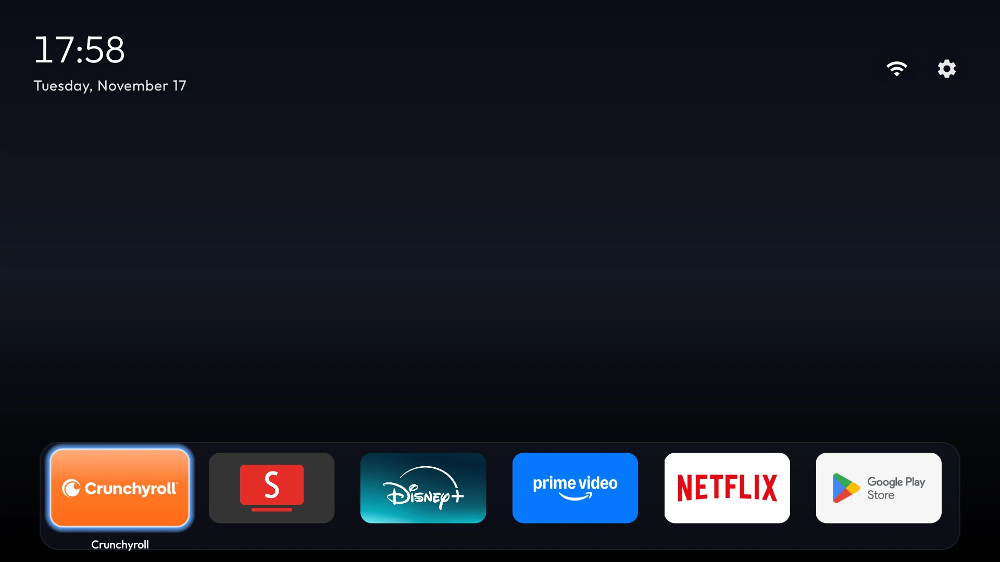
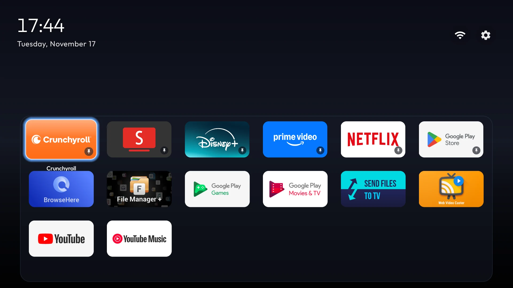
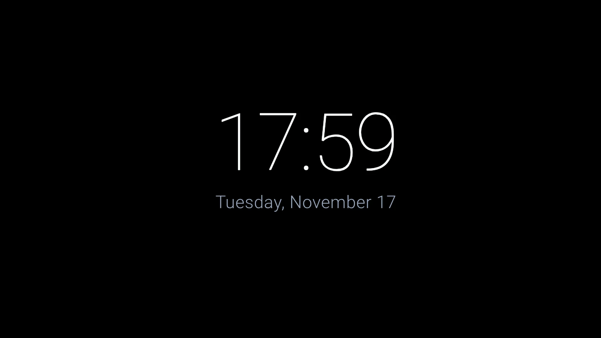

# NovaHome TV (v1.0 Estable)

<p align="center">
  <strong>Lanzador de aplicaciones (launcher) ultraligero, acelerado por hardware y enfocado en la privacidad para Android TV, desarrollado 100% en Java 17 puro.</strong><br>
  <em>Java 17 Puro &bull; Interfaz Nativa Android &bull; AndroidX RecyclerView y DynamicAnimation &bull; Sin Jetpack Compose &bull; Sin frameworks pesados</em>
</p>

<p align="center">
  <a href="README.md"><strong>English</strong></a> &bull; 
  <a href="README.es.md"><strong>Español</strong></a>
</p>

<p align="center">
  
  
  
  
  
  
</p>

---

## ¿Por qué NovaHome TV?

Los televisores inteligentes y dispositivos de streaming actuales sufren una degradación severa de rendimiento debido al diseño de sus interfaces de fábrica:

* **El Problema del Launcher Oficial:** El lanzador por defecto de Google TV / Android TV satura entre **250 MB y 450 MB de memoria RAM**, consume ancho de banda constante transmitiendo tráilers automáticos en 4K, despliega más de un **60% de publicidad no solicitada** en la pantalla de inicio y recopila telemetría de uso continua. En dispositivos de gama de entrada o televisores con 1 GB de RAM, esto genera congelamientos, cierres forzados de aplicaciones y lentitud insoportable al navegar con el control remoto.
* **La Solución NovaHome TV:** Diseñado desde cero como un lanzador minimalista, premium y autónomo. Consume **menos de 28.6 MB de RAM**, elimina el 100% de la publicidad y telemetría, ofrece personalización visual en tiempo real a 60/144 FPS y devuelve la respuesta instantánea del control remoto incluso en los televisores más económicos del mercado.

---

## Tabla Comparativa Técnica

| Característica / Criterio | Launcher Stock de Fábrica (Google TV) | CleanYourTV (Base Upstream) | NovaHome TV (v1.5) |
|---|---|---|---|
| **Consumo de Memoria RAM** | 250 MB – 450 MB (Crítico) | ~40 MB – 50 MB | **19.5 MB – 28.6 MB (Ultraligero)** |
| **Publicidad y Tráilers Automáticos** | Sí (Invasivo, > 60% de pantalla) | No (0% Publicidad) | **No (0% Publicidad, Cero Banners)** |
| **Telemetría y Conexiones en Fondo** | Constante (Google Analytics / Ads) | No | **Cero Peticiones (Privacidad Absoluta)** |
| **Personalización de Color y Estilo** | Ninguna (Fijo por fabricante) | Básica / Estática | **Matriz 2D HSV en Vivo, Opacidad y Radio** |
| **Sistema de Dock de Aplicaciones** | Renglón rígido predeterminado | Fijo (requiere fijado forzado) | **Bajo Demanda (0 a 6 apps) + Sustitución interactiva** |
| **Panel Flotante de Entradas (HDMI / AV)** | Menú lateral tosco del sistema | Menú de texto estándar | **Panel Simétrico Translúcido con Detección Automática** |
| **Modo Arte y Salvapantallas OLED** | Backdrop pesado con carga de red | No incluido | **Modo Arte Nativo + Clock Anti-Burn-In OLED** |
| **Soporte de Frecuencias Ultra-Altas** | Limitado por compositor stock | 60 Hz estándar | **Nativo 120 Hz / 144 Hz (`configureHighRefreshRate`)** |
| **Compatibilidad con TV Abierta (Sintonizador)** | Enlace interno propietario | Limitado | **Soporte Nativo Live TV (MediaTek / AOSP)** |

---

## Galería Visual

| Home Minimalista y Dock | Cajón de Aplicaciones Expandido |
|:---:|:---:|
|  |  |
| *Tarjetas enfocadas sobre cápsula oscura con efecto glassmorphism.* | *Cuadrícula continua de 3 filas con navegación fluida acelerada por GPU.* |
| Modo Arte (Sin Distracciones) | Salvapantallas Cinemático OLED |
|  |  |
| *Fondo ambiental limpio con reloj minimalista y fecha dinámica.* | *Reloj flotante ultra-ligero con protección anti-quemado OLED.* |

---

## Pilares del Proyecto

* **Arquitectura Nativa Ligera con AndroidX:** Desarrollado 100% en Java 17 puro utilizando APIs nativas de Android y soporte modular de AndroidX (`recyclerview:1.3.2` y `dynamicanimation:1.0.0`). Libre de capas pesadas en tiempo de ejecución (sin Jetpack Compose, sin Glide, sin Lottie y sin SDKs de publicidad o telemetría).
* **Consumo de Memoria Reducido:** Opera entre **19.5 MB – 28.6 MB de RAM Private Dirty** en todos sus estados de uso habitual, liberando la máxima memoria del sistema para aplicaciones de streaming y juegos.
* **Arquitectura para Paneles de Alta Frecuencia (60 Hz – 144 Hz):** Animaciones aceleradas por hardware en GPU (`translationY`, `alpha`, físicas de resorte) diseñadas para sincronizarse con la tasa de refresco nativa del panel (medido a 60 FPS estables en Mi Box 4, preparado para escalar a 120/144 Hz en televisores avanzados).
* **Dock Bajo Demanda:** Una instalación limpia inicia con 0 iconos fijados. Fija hasta 6 aplicaciones favoritas según tus preferencias, con un diálogo interactivo de sustitución 6/6 al completarse el cupo.
* **Selector HSV de Precisión Milimétrica:** Matriz 2D HSV dibujada en Canvas con barra horizontal de saturación y paso fino con la cruceta D-Pad (50 pasos por eje).
* **Ajustes Flotantes Alineados al Píxel:** El panel lateral sincroniza su borde derecho directamente con la cápsula del dock de forma milimétrica.
* **Núcleo Bilingüe y Localización Extendida:** Interfaz completamente auditada y mantenida de forma nativa en español e inglés según el idioma del sistema, incluyendo fechas y relojes dinámicos. Conserva además 23 idiomas heredados del upstream original (`res/values-*`) para cadenas básicas de TV y Leanback.
* **Privacidad Absoluta:** Cero telemetría, cero anuncios, cero librerías analíticas y cero peticiones de red en segundo plano.

---

## Controles del Mando a Distancia (D-Pad)

| Acción | Botón del Control |
|---|---|
| **Navegar por apps** | `D-Pad Izquierda / Derecha / Arriba / Abajo` |
| **Abrir aplicación enfocada** | `Botón Central (OK)` |
| **Expandir cajón completo** | `D-Pad Abajo` (desde el dock colapsado) |
| **Colapsar cajón al dock** | `D-Pad Arriba` o `Botón Atrás (Back)` |
| **Menú contextual de tarjeta** | `Mantener presionado OK (Long Press)` |
| **Mover tarjeta en el dock** | Seleccionar *Mover* en el menú y usar `D-Pad Izq / Der` |
| **Abrir panel de ajustes** | `D-Pad Arriba` (desde la fila superior) o icono de engranaje |

---

## Consumo de Memoria y Pruebas en Dispositivo Real

Medido en **Xiaomi Mi Box 4** (Modelo MDZ-16-AB, 2 GB RAM, Android TV 9 / API 28) mediante el analizador nativo del sistema (`dumpsys meminfo com.novahome.tv`):

| Estado Operativo | RAM Private Dirty | PSS Total | Dalvik Heap | Condiciones de Medición |
|---|---|---|---|---|
| **Reposo / Pantalla Principal** | **~19.5 MB** | ~26 MB | ~1.1 MB | Inicio limpio, dock minimizado colapsado (3 tarjetas fijadas). |
| **Navegación Activa (Cajón)** | **~20.7 MB** | ~27 MB | ~1.3 MB | Desplazamiento continuo en la cuadrícula de 3 filas de aplicaciones. |
| **Panel de Ajustes Abierto** | **~21.6 MB** | ~28 MB | ~1.4 MB | Selector HSV activo, ajuste de deslizadores y cambio de temas. |
| **Uso Intensivo / Pico Máximo** | **< 28.6 MB** | ~35 MB | ~2.1 MB | Desplazamiento rápido continuo y apertura repetitiva de menús. |

---

## Rendimiento y Clasificación por Gama de Dispositivo

NovaHome TV implementa perfiles dinámicos de optimización según la memoria disponible en el hardware del televisor (`isLowRamDevice()`):

| Gama de Hardware | Dispositivos de Referencia | Especificaciones Típicas | Comportamiento y Rendimiento con NovaHome TV |
|---|---|---|---|
| **Gama Baja / Entrada** | Smart TV Haier 32", Noblex, TCL básicas | $\le 1$ GB RAM, SoC MediaTek / Realtek quad-core Cortex-A53, GPU Mali-470 / 450 | **Revitalización total:** El launcher nativo de Google satura la memoria. NovaHome opera a < 28 MB de RAM con curva de animación ultraligera (150 ms) y renderizado directo en software para eliminar caídas de frames y tearing en GPUs básicas. |
| **Gama Media / Estándar** | Xiaomi Mi Box 4 / 4K, Chromecast con Google TV HD/4K, Fire TV Stick 4K | 1.5 GB – 2 GB RAM, SoC Amlogic S905X / S905L, GPU Mali-450 penta-core | **Fluidez constante a 60 FPS:** Multitarea estable en resolución 4K. La memoria adicional permite mantener el launcher en segundo plano sin cierres forzados por el sistema al alternar entre plataformas de streaming. |
| **Gama Media-Alta / Premium** | TCL 55P8L (QD-Mini LED), Sony Bravia XR, Philips The One / OLED | 3 GB RAM o superior, SoC MediaTek Pentonic 700 (MT9653) Cortex-A73, Panel 120 Hz / 144 Hz | **Rendimiento extremo:** Activación nativa de alta tasa de refresco (`configureHighRefreshRate()`) a 120 Hz / 144 Hz sin pérdidas de sincronización vertical. Los 3 GB de RAM y almacenamiento UFS aseguran transiciones instantáneas a nivel de consola. |

---

## Requisitos del Sistema

* **Sistema Operativo:** Android TV / Google TV 8.0 Oreo (API nivel 26) o superior.
* **Resolución:** 720p, 1080p Full HD, 4K UHD.
* **Entrada:** Control remoto estándar D-Pad / Leanback.

---

## Instalación

> [!NOTE]
> **Rendimiento y memoria del sistema:** NovaHome TV opera de forma completamente autónoma con menos de 28 MB de RAM y cero telemetría. Sin embargo, para recuperar entre 200 y 400 MB de memoria adicional en el televisor y evitar que el launcher predeterminado de Google continúe ejecutándose en segundo plano, se recomienda desactivar el launcher de fábrica mediante comandos ADB.

### Opción A: Instalar APK Precompilado de Lanzamiento

1. Descarga **`NovaHome-v1.0.apk`** desde [GitHub Releases](https://github.com/Jere150/NovaHome-TV/releases/tag/v1.0).
2. Habilita las **Opciones para desarrolladores** y la **Depuración por red / USB** en tu Android TV.
3. Conecta tu computadora al televisor mediante ADB:
   ```bash
   adb connect <IP_DE_TU_TV>:5555
   ```
4. Instala el paquete de lanzamiento:
   ```bash
   adb install -r NovaHome-v1.0.apk
   ```

---

### Opción B: Compilar e Instalar desde el Código Fuente

Para compilar desde el código fuente e instalarlo en tu televisor:

```bash
# Clonar el repositorio
git clone https://github.com/Jere150/NovaHome-TV.git
cd NovaHome-TV

# Compilar el APK debug con el wrapper de Gradle
./gradlew assembleDebug

# Instalar el APK compilado directamente en tu televisor
adb install -r -d app/build/outputs/apk/debug/app-debug.apk
```

#### Scripts Automatizados de Instalación Directa
También puedes compilar e instalar automáticamente en un solo paso:
* **Linux / macOS:**
  ```bash
  TV_HOST=192.168.1.50 ./build-and-install.sh
  ```
* **Windows (PowerShell):**
  ```powershell
  .\build-and-install.ps1 -TvHost 192.168.1.50
  ```

---

### Opción C: Instalación Directa mediante USB o App de Transferencia (Sin Computadora)

Si prefieres no usar una computadora ni comandos ADB:

1. Descarga el archivo **`NovaHome-v1.0.apk`** directamente desde [GitHub Releases](https://github.com/Jere150/NovaHome-TV/releases/tag/v1.0) en tu teléfono o computadora.
2. Transfiere el archivo APK a tu Android TV mediante cualquiera de estos métodos:
   * **Memoria USB (Pendrive):** Copia el archivo APK en un pendrive y conéctalo al puerto USB de tu televisor.
   * **App de transferencia inalámbrica:** Envía el archivo por Wi-Fi utilizando aplicaciones como *Send Files to TV (SFTV)* o *LocalSend* instaladas tanto en tu teléfono como en el televisor.
3. Abre cualquier explorador de archivos en tu televisor (por ejemplo, *AnExplorer*, *FX File Explorer* o *File Commander*).
4. Selecciona el archivo APK y pulsa **Instalar**.
   *(Si el sistema Android TV lo solicita, autoriza los permisos para "Instalar aplicaciones desconocidas" en Ajustes > Seguridad y restricciones).*

---

### Configuración del Salvapantallas y Modo Arte

NovaHome TV cuenta con su propio motor de **Modo Arte** y **Salvapantallas cinemático** de bajo consumo para proteger paneles OLED y LCD contra el quemado de imagen.

* **Comportamiento nativo:** NovaHome mantiene la pantalla activa mientras su salvapantallas interno está visible.
* **Coexistencia con Google Backdrop:** En ciertos modelos de Android TV / Google TV, el protector de pantalla de fábrica del sistema operativo puede forzar su aparición si detecta inactividad del control remoto. Para disfrutar del salvapantallas y Modo Arte de NovaHome de forma continua e ininterrumpida, puedes desactivar el salvapantallas nativo desde:
  * *Ajustes del TV $\rightarrow$ Preferencias del dispositivo $\rightarrow$ Salvapantallas $\rightarrow$ Desactivar (o fijar en tiempo mayor)*.
  * O bien ejecutar el siguiente comando por ADB:
    ```bash
    adb shell settings put secure screensaver_enabled 0
    ```

---

## Optimización y Debloating Seguro Reversible (Opcional)

Si deseas liberar entre **200 MB y 450 MB de memoria RAM** en tu televisor y evitar que el launcher de fábrica continúe ejecutándose en segundo plano consumiendo recursos y mostrando anuncios, puedes desactivarlo mediante ADB.

> [!IMPORTANT]
> **Totalmente Seguro y Reversible:** Este procedimiento no borra ninguna aplicación del sistema; únicamente desactiva temporalmente el lanzador de fábrica para el usuario actual. Puede revertirse en cualquier momento con un solo comando.

### 1. Desactivar el Launcher de Fábrica (según tu dispositivo)

Conéctate por ADB a tu televisor y ejecuta el comando correspondiente:

* **Google TV Moderno (Chromecast con Google TV, TCL recientes, Sony recientes):**
  ```bash
  adb shell pm disable-user --user 0 com.google.android.apps.tv.launcherx
  adb shell pm disable-user --user 0 com.google.android.tungsten.setupwraith
  ```
* **Android TV Estándar (Xiaomi Mi Box, Smart TVs Haier, Philips, Noblex):**
  ```bash
  adb shell pm disable-user --user 0 com.google.android.tvlauncher
  ```
* **Xiaomi PatchWall (Opcional, en televisores y boxes Xiaomi):**
  ```bash
  adb shell pm disable-user --user 0 com.mitv.tvhome
  ```

Al pulsar el botón **Home** de tu control remoto, NovaHome TV responderá de forma instantánea como el único lanzador principal del sistema.

### 2. Cómo Restaurar el Launcher de Fábrica (100% Reversible)

Si deseas volver al lanzador original en cualquier momento:

```bash
# Para Google TV
adb shell pm enable com.google.android.apps.tv.launcherx
adb shell pm enable com.google.android.tungsten.setupwraith

# Para Android TV Estándar
adb shell pm enable com.google.android.tvlauncher

# Para Xiaomi PatchWall
adb shell pm enable com.mitv.tvhome
```

---

## Preguntas Frecuentes (FAQ)

<details>
<summary><strong>¿NovaHome TV afecta mis cuentas, suscripciones o aplicaciones instaladas?</strong></summary>
<p>No. NovaHome TV es únicamente una interfaz visual de inicio (Launcher). No altera tus aplicaciones, no modifica certificados de seguridad DRM (Widevine L1 se mantiene intacto para 4K en Netflix, Disney+, Prime Video, etc.) ni interfiere con las sesiones activas de tus servicios de streaming.</p>
</details>

<details>
<summary><strong>¿Por qué no aparece el botón de Entradas (HDMI) en mi dispositivo?</strong></summary>
<p>El botón de Entradas en la cabecera cuenta con detección inteligente de hardware: solo se muestra en televisores reales que cuentan físicamente con puertos HDMI, AV o sintonizador de antena integrado. En decodificadores o cajas de streaming (como Xiaomi Mi Box o Fire TV Stick), el botón se oculta automáticamente para mantener el HUD limpio y sin accesos muertos.</p>
</details>

<details>
<summary><strong>¿Cómo cargo fondos de pantalla personalizados?</strong></summary>
<p>Puedes conectar un pendrive USB al televisor o enviar cualquier imagen (JPG o PNG en 1080p o 4K) mediante aplicaciones como <em>Send Files to TV</em>. Luego abre los <strong>Ajustes de NovaHome</strong> (icono de engranaje), ve a la sección <em>Personalización y Sistema</em>, selecciona <strong>Fondo de pantalla &rarr; Elegir</strong> y escoge la imagen con tu explorador de archivos preferido.</p>
</details>

<details>
<summary><strong>¿Cómo reemplazo una aplicación cuando el dock tiene las 6 tarjetas ocupadas?</strong></summary>
<p>Despliega el cajón completo pulsando Flecha Abajo en el control remoto. Posiciónate sobre cualquier aplicación que no esté en el dock, mantén presionado el botón central <strong>OK</strong> y selecciona <strong>Fijar en dock</strong>. El dock se contraerá automáticamente a una fila: usa Izquierda/Derecha para posarte sobre la tarjeta que deseas sustituir y pulsa <strong>OK</strong> para confirmar (o Atrás para cancelar).</p>
</details>

<details>
<summary><strong>¿Puedo desinstalar NovaHome TV de forma normal?</strong></summary>
<p>Sí. Antes de desinstalar, asegúrate de reactivar el launcher de fábrica con los comandos de reversión indicados arriba, o bien instala otro launcher de respaldo. Luego puedes desinstalar NovaHome TV directamente desde los Ajustes de Android TV &rarr; Aplicaciones &rarr; NovaHome TV &rarr; Desinstalar.</p>
</details>

---

---

## Licencia y Reconocimientos a Terceros

NovaHome TV se distribuye bajo la [Licencia MIT](LICENSE).

### Atribución y Créditos del Proyecto Base
NovaHome TV nació como una evolución y adaptación personalizada a partir de [CleanYourTV](https://github.com/Gathin23/cleanyourtv) por [Gathin](https://github.com/Gathin23) (distribuido bajo licencia MIT).

* **Base Original:** Estructura inicial de actividad Leanback, navegación básica con control remoto D-pad y configuración de recursos tipográficos.
* **Aportes y Reingeniería Propia en NovaHome TV:**
  * Sistema de dock fijado bajo demanda (0 a 6 aplicaciones con diálogo interactivo de sustitución 6/6).
  * Cápsula de dock fija de 6 tarjetas con centrado simétrico dibujada en Canvas nativo (`DockDecoration`).
  * Panel de ajustes rápidos flotante alineado milimétricamente con el borde derecho del dock.
  * Selector de color HSV matricial 2D en Canvas con barra de saturación y paso fino con la cruceta D-Pad.
  * Sincronización en tiempo real del color del dock, resplandor y fondo del panel de ajustes.
  * Modo Arte y salvapantallas cinemático dinámico con protección anti-quemado OLED.
  * Localización bilingüe automática (Español e Inglés) y adaptación dinámica de formato de fecha.
  * Optimización de consumo de memoria (< 28.6 MB de RAM Private Dirty) en Java 17 puro con arquitectura de interfaz nativa AndroidX ligera.
* **Autor y Desarrollador Principal:** [Jere150](https://github.com/Jere150).
