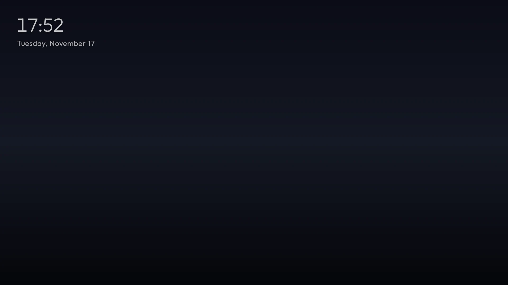

# NovaHome TV (v1.0.0 Estable)

<p align="center">
  <strong>Lanzador de aplicaciones (launcher) ultraligero, acelerado por hardware y enfocado en la privacidad para Android TV, desarrollado 100% en Java 17 puro.</strong><br>
  <em>Java 17 Puro &bull; Interfaz Nativa Android &bull; AndroidX RecyclerView y DynamicAnimation &bull; Sin Jetpack Compose &bull; Sin frameworks pesados</em>
</p>

<p align="center">
  <a href="README.md"><strong>English</strong></a> &bull; 
  <a href="README.es.md"><strong>Español</strong></a>
</p>

<p align="center">
  
  
  
  
  
  
</p>

---

## Galería Visual

| Home Minimalista y Dock | Cajón de Aplicaciones Expandido |
|:---:|:---:|
|  |  |
| *Tarjetas enfocadas sobre cápsula oscura con efecto glassmorphism.* | *Cuadrícula continua de 3 filas con navegación fluida acelerada por GPU.* |
| Modo Arte (Sin Distracciones) | Salvapantallas Cinemático OLED |
|  |  |
| *Fondo ambiental limpio con reloj minimalista y fecha dinámica.* | *Reloj flotante ultra-ligero con protección anti-quemado OLED.* |

---

## Pilares del Proyecto

* **Arquitectura Nativa Ligera con AndroidX:** Desarrollado 100% en Java 17 puro utilizando APIs nativas de Android y soporte modular de AndroidX (`recyclerview:1.3.2` y `dynamicanimation:1.0.0`). Libre de capas pesadas en tiempo de ejecución (sin Jetpack Compose, sin Glide, sin Lottie y sin SDKs de publicidad o telemetría).
* **Consumo de Memoria Reducido:** Opera entre **19.5 MB – 28.6 MB de RAM Private Dirty** en todos sus estados de uso habitual, liberando la máxima memoria del sistema para aplicaciones de streaming y juegos.
* **Arquitectura para Paneles de Alta Frecuencia (60 Hz – 144 Hz):** Animaciones aceleradas por hardware en GPU (`translationY`, `alpha`, físicas de resorte) diseñadas para sincronizarse con la tasa de refresco nativa del panel (medido a 60 FPS estables en Mi Box 4, preparado para escalar a 120/144 Hz en televisores avanzados).
* **Dock Bajo Demanda:** Una instalación limpia inicia con 0 iconos fijados. Fija hasta 6 aplicaciones favoritas según tus preferencias, con un diálogo interactivo de sustitución 6/6 al completarse el cupo.
* **Selector HSV de Precisión Milimétrica:** Matriz 2D HSV dibujada en Canvas con barra horizontal de saturación y paso fino con la cruceta D-Pad (50 pasos por eje).
* **Ajustes Flotantes Alineados al Píxel:** El panel lateral sincroniza su borde derecho directamente con la cápsula del dock de forma milimétrica.
* **Soporte Bilingüe Automático:** Interfaz completamente localizada en español e inglés según el idioma del sistema, incluyendo formatos de fecha y hora dinámicos.
* **Privacidad Absoluta:** Cero telemetría, cero anuncios, cero librerías analíticas y cero peticiones de red en segundo plano.

---

## Controles del Mando a Distancia (D-Pad)

| Acción | Botón del Control |
|---|---|
| **Navegar por apps** | `D-Pad Izquierda / Derecha / Arriba / Abajo` |
| **Abrir aplicación enfocada** | `Botón Central (OK)` |
| **Expandir cajón completo** | `D-Pad Abajo` (desde el dock colapsado) |
| **Colapsar cajón al dock** | `D-Pad Arriba` o `Botón Atrás (Back)` |
| **Menú contextual de tarjeta** | `Mantener presionado OK (Long Press)` |
| **Mover tarjeta en el dock** | Seleccionar *Mover* en el menú y usar `D-Pad Izq / Der` |
| **Abrir panel de ajustes** | `D-Pad Arriba` (desde la fila superior) o icono de engranaje |

---

## Consumo de Memoria y Pruebas en Dispositivo Real

Medido en **Xiaomi Mi Box 4** (Modelo MDZ-16-AB, 2 GB RAM, Android TV 9 / API 28) mediante el analizador nativo del sistema (`dumpsys meminfo com.novahome.tv`):

| Estado Operativo | RAM Private Dirty | PSS Total | Dalvik Heap | Condiciones de Medición |
|---|---|---|---|---|
| **Reposo / Pantalla Principal** | **~19.5 MB** | ~26 MB | ~1.1 MB | Inicio limpio, dock minimizado colapsado (3 tarjetas fijadas). |
| **Navegación Activa (Cajón)** | **~20.7 MB** | ~27 MB | ~1.3 MB | Desplazamiento continuo en la cuadrícula de 3 filas de aplicaciones. |
| **Panel de Ajustes Abierto** | **~21.6 MB** | ~28 MB | ~1.4 MB | Selector HSV activo, ajuste de deslizadores y cambio de temas. |
| **Uso Intensivo / Pico Máximo** | **< 28.6 MB** | ~35 MB | ~2.1 MB | Desplazamiento rápido continuo y apertura repetitiva de menús. |

---

## Requisitos del Sistema

* **Sistema Operativo:** Android TV / Google TV 8.0 Oreo (API nivel 26) o superior.
* **Resolución:** 720p, 1080p Full HD, 4K UHD.
* **Entrada:** Control remoto estándar D-Pad / Leanback.

---

## Instalación

> [!NOTE]
> **Rendimiento y memoria del sistema:** NovaHome TV opera de forma completamente autónoma con menos de 28 MB de RAM y cero telemetría. Sin embargo, para recuperar entre 200 y 400 MB de memoria adicional en el televisor y evitar que el launcher predeterminado de Google continúe ejecutándose en segundo plano, se recomienda desactivar el launcher de fábrica mediante comandos ADB.

### Opción A: Instalar APK Precompilado de Lanzamiento

1. Descarga **`NovaHome-v1.0.0.apk`** desde [GitHub Releases](https://github.com/Jere150/NovaHome-TV/releases/tag/v1.0.0).
2. Habilita las **Opciones para desarrolladores** y la **Depuración por red / USB** en tu Android TV.
3. Conecta tu computadora al televisor mediante ADB:
   ```bash
   adb connect <IP_DE_TU_TV>:5555
   ```
4. Instala el paquete de lanzamiento:
   ```bash
   adb install -r NovaHome-v1.0.0.apk
   ```

---

### Opción B: Compilar e Instalar desde el Código Fuente

Para compilar desde el código fuente e instalarlo en tu televisor:

```bash
# Clonar el repositorio
git clone https://github.com/Jere150/NovaHome-TV.git
cd NovaHome-TV

# Compilar el APK debug con el wrapper de Gradle
./gradlew assembleDebug

# Instalar el APK compilado directamente en tu televisor
adb install -r -d app/build/outputs/apk/debug/app-debug.apk
```

#### Scripts Automatizados de Instalación Directa
También puedes compilar e instalar automáticamente en un solo paso:
* **Linux / macOS:**
  ```bash
  TV_HOST=192.168.1.50 ./build-and-install.sh
  ```
* **Windows (PowerShell):**
  ```powershell
  .\build-and-install.ps1 -TvHost 192.168.1.50
  ```

---

## Licencia y Reconocimientos a Terceros

NovaHome TV se distribuye bajo la [Licencia MIT](LICENSE).

### Atribución y Créditos del Proyecto Base
NovaHome TV nació como una evolución y adaptación personalizada a partir de [CleanYourTV](https://github.com/Gathin23/cleanyourtv) por [Gathin](https://github.com/Gathin23) (distribuido bajo licencia MIT).

* **Base Original:** Estructura inicial de actividad Leanback, navegación básica con control remoto D-pad y configuración de recursos tipográficos.
* **Aportes y Reingeniería Propia en NovaHome TV:**
  * Sistema de dock fijado bajo demanda (0 a 6 aplicaciones con diálogo interactivo de sustitución 6/6).
  * Cápsula de dock fija de 6 tarjetas con centrado simétrico dibujada en Canvas nativo (`DockDecoration`).
  * Panel de ajustes rápidos flotante alineado milimétricamente con el borde derecho del dock.
  * Selector de color HSV matricial 2D en Canvas con barra de saturación y paso fino con la cruceta D-Pad.
  * Sincronización en tiempo real del color del dock, resplandor y fondo del panel de ajustes.
  * Modo Arte y salvapantallas cinemático dinámico con protección anti-quemado OLED.
  * Localización bilingüe automática (Español e Inglés) y adaptación dinámica de formato de fecha.
  * Optimización de consumo de memoria (< 28.6 MB de RAM Private Dirty) en Java 17 puro con arquitectura de interfaz nativa AndroidX ligera.
* **Autor y Desarrollador Principal:** [Jere150](https://github.com/Jere150).
