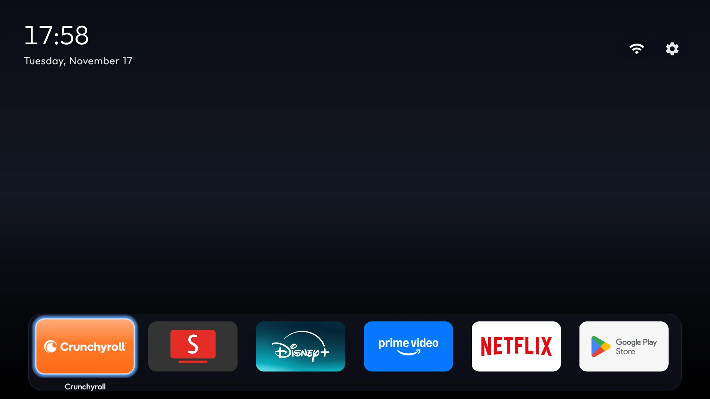
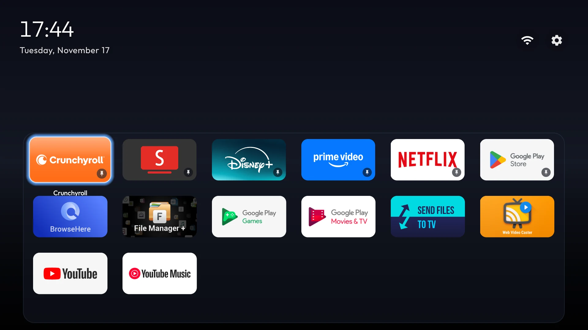
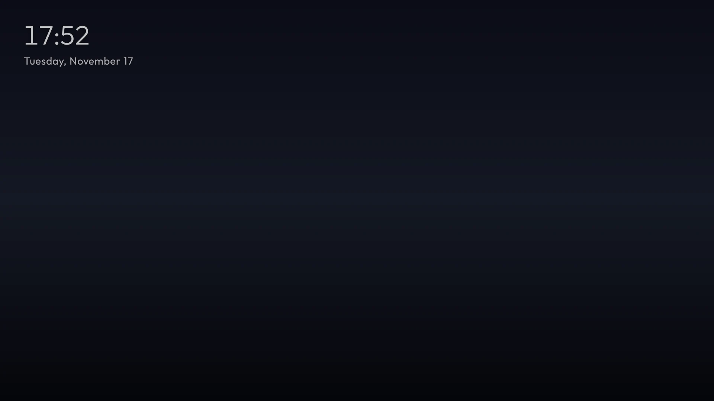
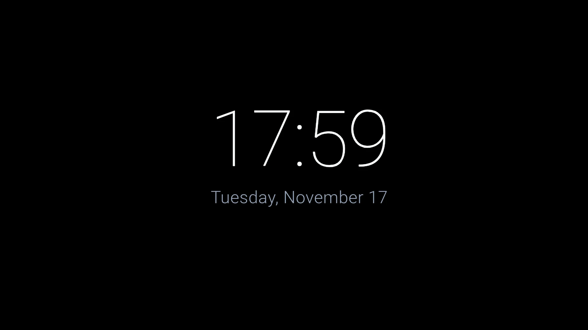

# NovaHome TV (v1.0.0 Stable)

<p align="center">
  <strong>Ultra-lightweight, hardware-accelerated, and privacy-focused Android TV launcher written in 100% pure Java 17.</strong><br>
  <em>Pure Java 17 &bull; Native Android UI &bull; AndroidX RecyclerView &amp; DynamicAnimation &bull; No Jetpack Compose &bull; No heavy runtime frameworks</em>
</p>

<p align="center">
  <a href="README.md"><strong>English</strong></a> &bull; 
  <a href="README.es.md"><strong>Español</strong></a>
</p>

<p align="center">
  
  
  
  
  
  
</p>

---

## Visual Showcase

| Minimalist Home & Dock | Expanded Application Drawer |
|:---:|:---:|
|  |  |
| *Focused cards on clean dark glassmorphism dock.* | *Continuous 3-row grid with fluid GPU-accelerated navigation.* |
| Art Mode (Uncluttered) | Cinematic OLED Screensaver |
|  |  |
| *Clean ambient backdrop with minimal clock and dynamic date.* | *Ultra-lightweight floating clock with anti-burn-in protection.* |

---

## Key Highlights

* **Lean Native AndroidX Architecture:** Built 100% in pure Java 17 using native Android APIs and lean modular AndroidX support (`recyclerview:1.3.2` and `dynamicanimation:1.0.0`). Completely free of heavy runtime layers (no Jetpack Compose, no Glide, no Lottie, no telemetry or advertising SDKs).
* **Exceptional Memory Efficiency:** Operates between **19.5 MB – 28.6 MB Private Dirty RAM** across all typical usage states, freeing up maximum memory for demanding streaming apps and games.
* **High-Refresh Display Architecture (60 Hz – 144 Hz ready):** Hardware-accelerated GPU animations (`translationY`, `alpha`, spring physics) engineered to synchronize with native panel refresh rates (tested at locked 60 FPS on Mi Box 4, designed to scale up to 120/144 Hz on high-refresh TV panels).
* **Demand-Driven Dock:** A clean install starts completely uncluttered with 0 pinned icons. Pin up to 6 favourite apps on demand with an intuitive 6/6 interactive replacement dialog.
* **Millimeter-Accurate HSV Color Picker:** Native Canvas-drawn 2D HSV matrix with dedicated horizontal saturation bar and fine-grained D-Pad step control (50 steps per axis).
* **Pixel-Aligned Floating Quick Settings:** The settings window dynamically synchronizes its right edge with the dock capsule down to the exact subpixel.
* **Automatic Bilingual Support:** Fully localized in English and Spanish based on system locale, including formatted dynamic dates and clocks.
* **Privacy by Design:** Zero analytics, zero telemetry, zero advertising SDKs, and zero background network polling.

---

## Remote Control Navigation (D-Pad)

| Action | Remote Key |
|---|---|
| **Navigate apps** | `D-Pad Left / Right / Up / Down` |
| **Open focused app** | `Center Button (OK)` |
| **Expand application drawer** | `D-Pad Down` (from collapsed dock) |
| **Collapse drawer to dock** | `D-Pad Up` or `Back Button` |
| **Tile context menu** | `Hold OK (Long Press)` on any tile |
| **Move tile within dock** | Select *Move* in inline menu, then use `D-Pad Left / Right` |
| **Open Quick Settings** | `D-Pad Up` (from top row) or select settings gear icon |

---

## Memory Footprint & Real-Device Benchmarks

Tested on **Xiaomi Mi Box 4** (Model MDZ-16-AB, 2 GB RAM, Android TV 9 / API 28) measured via Android native memory inspector (`dumpsys meminfo com.novahome.tv`):

| Operational State | Private Dirty RAM | Total PSS | Dalvik Heap | Measurement Conditions |
|---|---|---|---|---|
| **Idle / Home Screen** | **~19.5 MB** | ~26 MB | ~1.1 MB | Clean boot, minimalist dock collapsed (3 pinned cards). |
| **Active App Browsing** | **~20.7 MB** | ~27 MB | ~1.3 MB | Continuous navigation across 3-row expanded app drawer. |
| **Quick Settings Open** | **~21.6 MB** | ~28 MB | ~1.4 MB | Real-time HSV picker, slider dragging, and theme changes. |
| **Peak Usage / Stress** | **< 28.6 MB** | ~35 MB | ~2.1 MB | Rapid continuous scrolling and repetitive dialog toggling. |

---

## System Requirements

* **OS:** Android TV / Google TV 8.0 Oreo (API level 26) or higher.
* **Resolution:** 720p, 1080p Full HD, 4K UHD.
* **Input:** Standard Android TV D-Pad remote control.

---

## Installation

> [!NOTE]
> **System Memory & Optimization Note:** NovaHome TV operates independently consuming under 28 MB of RAM with zero telemetry. However, to reclaim 200–400 MB of system RAM on your TV and prevent the stock Google launcher from running in the background, disabling the stock launcher via ADB is recommended.

### Option A: Install Pre-Built Release APK

1. Download **`NovaHome-v1.0.0.apk`** from [GitHub Releases](https://github.com/Jere150/NovaHome-TV/releases/tag/v1.0.0).
2. Enable **Developer Options** and **Network / USB Debugging** on your Android TV.
3. Connect your computer to your TV over ADB:
   ```bash
   adb connect <YOUR_TV_IP>:5555
   ```
4. Install the release package:
   ```bash
   adb install -r NovaHome-v1.0.0.apk
   ```

---

### Option B: Build and Install from Source

To compile from source and deploy to your Android TV:

```bash
# Clone the repository
git clone https://github.com/Jere150/NovaHome-TV.git
cd NovaHome-TV

# Build the debug APK with Gradle wrapper
./gradlew assembleDebug

# Install the compiled APK directly to your connected TV
adb install -r -d app/build/outputs/apk/debug/app-debug.apk
```

#### Automated One-Step Deploy Scripts
You can also build and install automatically in a single command:
* **Linux / macOS:**
  ```bash
  TV_HOST=192.168.1.50 ./build-and-install.sh
  ```
* **Windows (PowerShell):**
  ```powershell
  .\build-and-install.ps1 -TvHost 192.168.1.50
  ```

---

## License & Third-Party Attribution

NovaHome TV is released under the [MIT License](LICENSE).

### Upstream Attribution & Credits
NovaHome TV originated as a customized evolution derived from [CleanYourTV](https://github.com/Gathin23/cleanyourtv) by [Gathin](https://github.com/Gathin23) (licensed under MIT).

* **Base Foundation:** Initial Leanback activity scaffolding, fundamental D-pad navigation structure, and asset configurations.
* **NovaHome TV Contributions & Custom Engineering:**
  * Completely revamped pinned dock system (demand-driven 0 to 6 items with 6/6 interactive replacement dialog).
  * Symmetrical fixed-width 6-tile dock capsule rendering in custom Canvas (`DockDecoration`).
  * Floating Quick Settings panel dynamically aligned with the dock's right edge.
  * Native 2D Canvas HSV color picker with dedicated saturation slider and fine-stepped D-pad matrix.
  * Real-time dock, glow, and settings color synchronization engine.
  * Ambient screensaver and Art Mode system with anti-burn-in clock protection.
  * Automatic bilingual localization (English / Spanish) with dynamic date formatting.
  * Strict memory footprint optimization (< 28.6 MB Private Dirty RAM) in pure Java 17 with lean AndroidX UI architecture.
* **Author & Lead Maintainer:** [Jere150](https://github.com/Jere150).
